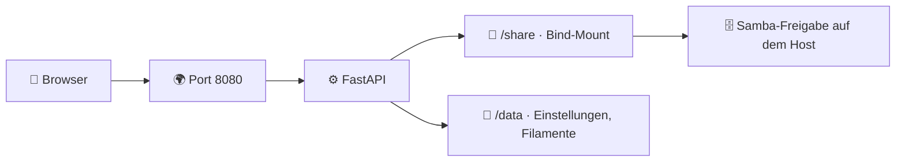

<p align="center"><a href="https://www.buymeacoffee.com/highfish"></a></p>

# 🧊 hAI.3DDir

> Self-hosted **Weboberfläche für deine Samba-Freigabe mit 3D-Druckdateien** inklusive **Filamentrollen-Verwaltung**. Gebaut für das **LAN** mit **Portainer** und **ghcr.io**.

[](https://github.com/jbkunama1/hAI.3DDir)
[](https://github.com/jbkunama1/hAI.3DDir)
[](https://github.com/jbkunama1/hAI.3DDir)
[](https://github.com/jbkunama1/hAI.3DDir/actions)
[](https://jbkunama1.github.io/hAI.3DDir/)

---

## ✨ Features

- 📁 Ordner navigieren, hochladen (Drag & Drop mit Fortschritt), herunterladen, umbenennen, neue Ordner
- 🔎 Suche über die ganze Freigabe
- ☑️ Mehrfachauswahl mit 📦 ZIP-Download, Verschieben (Ordner-Dialog oder Drag & Drop) und Löschen
- 🗑️ Papierkorb mit Wiederherstellen und automatischem Leeren
- 🧊 3D-Vorschau für STL, 3MF und OBJ mit Maßangabe
- 🖼️ Thumbnails im Raster (im Browser gerendert, lokal gecacht, Größenlimit im Admin-Tab)
- 🎨 Filamentverwaltung: Marke, Material, Farbe, Gewicht gesamt und Rest, Import und Export (CSV/JSON)
- 🛠️ Admin-Tab: Statistik, Titel, Standard-Theme, Upload-Limit, Endungen, Papierkorb, Passwort
- 🤖 Telegram-Bot mit Inline-Buttons: Dateien durchklicken und senden, Dateien hochladen, Filament abbuchen, Warnungen
- 🌈 5 Themes: Modern, Nacht, Bunt, Werkstatt, Galaxie (jeweils mit eigenen Emojis)
- 📱 Mobile Ansicht mit Tab-Leiste unten und Zwei-Spalten-Raster
- 🔐 Passwortschutz, Rate-Limit, Schutz gegen Path-Traversal

---

## 🖼️ Architektur



---

## 📁 Projektstruktur

```
.
├── app/
│   ├── main.py            # FastAPI-Backend
│   └── static/index.html  # komplette Weboberfläche
├── docs/index.html        # GitHub Pages
├── .github/workflows/     # docker.yml (ghcr) + pages.yml
├── docker-compose.yml
├── Dockerfile
└── README.md
```

---

## 🚀 Deployment mit Portainer

1. Repo nach GitHub pushen, die Action baut `ghcr.io/jbkunama1/hai.3ddir`.
2. Package auf ghcr öffentlich stellen, oder in Portainer eine Registry mit PAT (`read:packages`) anlegen.
3. Netzwerk anlegen, falls es fehlt: `docker network create highfishNetwork`
4. In Portainer **Stacks → Add stack**, `docker-compose.yml` einfügen und die ENVs setzen.
5. Öffnen: `http://DEINE-IP:8080`

### ⚙️ Umgebungsvariablen

| ENV | Bedeutung |
|---|---|
| `ADMIN_PASSWORD` | Startpasswort (Standard `changeme`, bitte setzen) |
| `SECRET_KEY` | Zufälliger String für Sessions (`openssl rand -hex 32`) |
| `SHARE_HOST_PATH` | Host-Pfad der Samba-Freigabe |
| `PUID` / `PGID` | Benutzer und Gruppe, die auf dem Share schreiben (Standard 1000) |
| `MAX_UPLOAD_MB` | Start-Upload-Limit, später im Admin-Tab änderbar |
| `TELEGRAM_BOT_TOKEN` | Token von @BotFather (leer = Bot aus) |
| `TELEGRAM_ALLOWED_IDS` | Erlaubte Telegram-IDs, kommagetrennt |
| `PORT`, `TZ` | Host-Port, Zeitzone |

Nach einer Passwortänderung im Admin-Tab gilt das neue Passwort statt `ADMIN_PASSWORD`. Für HTTPS einen Reverse-Proxy davorsetzen.

---

## 🤖 Telegram-Bot

1. Bei **@BotFather** mit `/newbot` einen Bot anlegen und den Token als `TELEGRAM_BOT_TOKEN` eintragen.
2. Dem neuen Bot einmal eine Nachricht schicken. Er antwortet mit deiner ID, die du als `TELEGRAM_ALLOWED_IDS` einträgst (mehrere mit Komma). Stack neu starten.
3. `/menu` öffnet das Hauptmenü mit Inline-Buttons:
   - 📁 **Dateien:** Ordner durchklicken, Tipp auf eine Datei sendet sie dir (bis 50 MB)
   - 🔎 **Suche:** Begriff senden oder `/search begriff`
   - ⬆️ **Upload:** Datei an den Bot schicken (bis 20 MB), Zielordner per Button wählen, mit „Hier speichern“ ablegen
   - 🧵 **Filamente:** Rolle antippen, mit −10/−50/−100 g abbuchen oder den Wert setzen
   - 🔔 **Warnungen:** bei wenig Restgewicht und bei Uploads aus der Weboberfläche (Schwelle im Admin-Tab)

Der Bot nutzt Long Polling, ein offener Port ist nicht nötig. Nur IDs auf der Whitelist dürfen ihn bedienen.

---

## 🌐 GitHub Pages

Unter **Settings → Pages → Source** den Eintrag **GitHub Actions** wählen. Die Seite aus `docs/` erscheint dann unter `https://jbkunama1.github.io/hAI.3DDir/`.

---

## 🩺 Healthcheck

```
curl http://DEINE-IP:8080/health
```

Erwartete Antwort: `{"status":"ok"}`

---

## 🗺️ Roadmap

- 🧵 Filament-Verbrauch pro Druck abbuchen

---

## 🙌 Lizenz

MIT, siehe [LICENSE](LICENSE). Gelöschte Dateien liegen im Papierkorb unter `.trash` in der Freigabe, bis er geleert wird.
