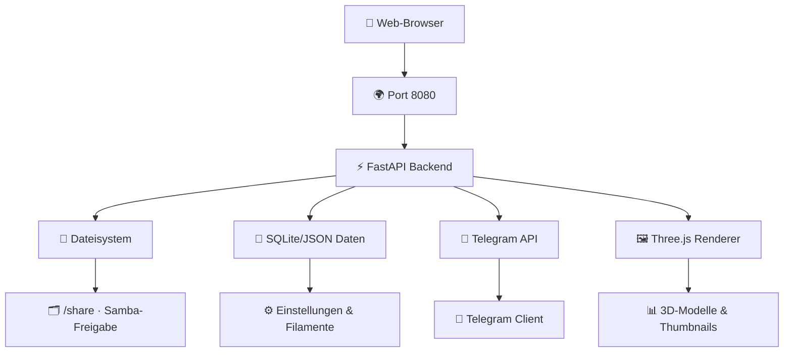

<p align="center"><a href="https://www.buymeacoffee.com/highfish"></a></p>

# 🧊 hAI.3DDir

> **Self-hosted Weboberfläche für deine Samba-Freigabe mit 3D-Druckdateien** inklusive **Filamentrollen-Verwaltung**. Gebaut für das **LAN** mit **Portainer** und **ghcr.io**.

[](https://github.com/jbkunama1/hAI.3DDir)
[](https://github.com/jbkunama1/hAI.3DDir)
[](https://github.com/jbkunama1/hAI.3DDir)
[](https://github.com/jbkunama1/hAI.3DDir/actions)
[](https://jbkunama1.github.io/hAI.3DDir/)
[](https://github.com/jbkunama1/hAI.3DDir/blob/main/LICENSE)

---

## ✨ Features

### 📁 Dateiverwaltung
- **Ordner navigieren** mit Baumstruktur und Breadcrumb-Navigation
- **Upload** mit Drag & Drop und Fortschrittsanzeige (bis 500 MB)
- **Download** einzelner Dateien oder komprimierter ZIP-Ordner
- **Umbenennen** und **neue Ordner erstellen**
- **Mehrfachauswahl** mit Batch-Operationen
- 🔍 **Globale Suche** über die gesamte Freigabe

### 🗑️ Papierkorb-System
- Wiederherstellung gelöschter Dateien
- Automatisches Leeren nach 30 Tagen (konfigurierbar)
- Sichtverwaltung des Papierkorbs mit Sortieroptionen

### 🧊 3D-Vorschau
- **STL, 3MF, OBJ** Dateien interaktiv drehen, zoomen und messen
- **Maßangaben** und 3D-Koordinaten im Viewer
- **Optimiertes Rendering** mit WebGL Three.js

### 🖼️ Thumbnails
- **Automatische Erstellung** im Browser gerendert
- **Lokaler Cache** für schnelle Wiederverwendung
- **Größenbegrenzung** (20 MB) und Konfiguration im Admin-Tab

### 🎨 Filament-Management
- **Detaillierte Verwaltung**: Marke, Material, Farbe, Gewicht
- **Verbrauchstracking**: Gesamtgewicht vs. Restgewicht
- **Import/Export**: CSV und JSON Formate
- **Benutzerdefinierte Kategorien und Notizen**

### 🛠️ Admin-Funktionen
- **Statistiken**: Dateianzahl, Speicherbelegung, Upload-Metriken
- **Theme-Konfiguration**: 5 verschiedene Designs
- **Sicherheit**: Passwort, Rate-Limit, Path-Traversal-Schutz
- **Einstellungen**: Upload-Limits, erlaubte Dateiendungen
- **Benachrichtigungen**: Telegram-Integration

### 🤖 Telegram-Bot
- **Datei-Explorer**: Ordner durchklicken und senden (bis 50 MB)
- **Suchfunktion**: Schnellzugriff auf Dateien
- **Upload-Bot**: Direkter Dateiupload mit Zielordner-Auswahl
- **Filament-Management**: Gewicht abbuchen und Warnungen
- **Push-Benachrichtigungen**: Bei niedrigem Filamentbestand

### 🌈 Themes & Design
- **5 Themes**: Modern, Nacht, Bunt, Werkstatt, Galaxie
- **Responsive Design**: Optimiert für Desktop, Tablet & Mobile
- **Dark/Light Mode**: Automatische Erkennung und manuelle Auswahl
- **Emoji-Icons**: Intuitive Benutzeroberfläche

### 🔐 Sicherheit & Performance
- **Session-basierter Zugriff** mit CSRF-Schutz
- **Rate Limiting** zum Schutz vor Missbrauch
- **Path-Traversal Protection** für sichere Dateizugriffe
- **HTTPS-fähig** (Proxy-kompatibel)

---

## 🖼️ Architektur



### Komponenten-Übersicht
- **Frontend**: Single Page Application (SPA) mit Three.js für 3D-Rendering
- **Backend**: FastAPI mit Session-Management und File-Handling
- **Datenpersistenz**: JSON-Files für Settings & Filamente, SQLite für Protokolle
- **Dienste**: Telegram Bot, Thumbnail Generation, Search Index

---

## 📁 Projektstruktur

```
hAI.3DDir/
├── app/
│   ├── __init__.py          # Paket-Initialisierung
│   ├── main.py              # FastAPI Application & API Routes
│   ├── telegram_bot.py      # Telegram Bot Integration
│   └── static/
│       └── index.html       # SPA Frontend (Vue.js + Three.js)
├── docs/
│   └── index.html          # GitHub Landing Page
├── .github/
│   └── workflows/
│       ├── docker.yml       # Docker Build & ghcr.io Publish
│       └── pages.yml       # GitHub Pages Deployment
├── docker-compose.yml      # Docker Compose Konfiguration
├── Dockerfile              # Multi-stage Docker Build
├── .gitignore              # Git Ignore Patterns
├── LICENSE                 # MIT License
└── README.md               # Projekt-Dokumentation
```

### Kernkomponenten

#### 🚀 Backend (FastAPI)
- **API-Routes**: RESTful Endpoints für Dateiverwaltung, Authentifizierung
- **Session-Management**: Cookie-basierte Authentifizierung
- **File-Operations**: Safe Path Handling, Upload/Download Management
- **Telegram Integration**: Bot Commands und Inline-Buttons

#### 🎨 Frontend (SPA)
- **Vue.js 3**: Reactive User Interface Components
- **Three.js**: 3D Model Viewer mit Maussteuerung
- **CSS Grid**: Responsive Layout für Mobile & Desktop
- **Local Storage**: Cache für Thumbnails und User Preferences

#### 🤖 Telegram Bot
- **Long Polling**: Effiziente Nachrichtenverarbeitung
- **Inline Buttons**: Intuitive Menüführung
- **File Upload**: Direkte Dateiübertragung zum Server
- **Notifications**: Automatische Warnungen bei Filament-Niedrigstand

---

## 🚀 Deployment Optionen

### Option 1: Portainer Stack (Empfohlen)

1. **GitHub Repo pushen** - Die GitHub Action baut automatisch `ghcr.io/jbkunama1/hai.3ddir`
2. **Docker Image konfigurieren**:
   - Öffentlich: Package auf ghcr.io als "public" markieren
   - Privat: In Portainer Registry mit PAT (`read:packages`) verbinden
3. **Netzwerk erstellen** (falls nicht vorhanden):
   ```bash
   docker network create highfishNetwork
   ```
4. **Portainer Stack erstellen**:
   - **Stacks → Add stack**
   - `docker-compose.yml` Inhalte einfügen
   - Umgebungsvariablen in der UI setzen
5. **Anwendung starten**: `http://DEINE-IP:8080`

### Option 2: Docker Compose direkt

```bash
git clone https://github.com/jbkunama1/hAI.3DDir.git
cd hAI.3DDir
docker-compose up -d
```

### Option 3: Docker Run

```bash
docker run -d \
  --name hai-3ddir \
  --network highfishNetwork \
  -e ADMIN_PASSWORD="dein-passwort" \
  -e SECRET_KEY="$(openssl rand -hex 32)" \
  -e SHARE_HOST_PATH="/pfad/zur/samba/freigabe" \
  -e PUID=1000 -e PGID=1000 \
  -e MAX_UPLOAD_MB=500 \
  -p 8080:8080 \
  ghcr.io/jbkunama1/hai.3ddir:latest
```

### ⚙️ Umgebungsvariablen

| Variable | Standard | Beschreibung |
|----------|----------|-------------|
| `ADMIN_PASSWORD` | `changeme` | Admin Passwort (Änderung empfohlen!) |
| `SECRET_KEY` | Auto-generated | Session Secret (`openssl rand -hex 32`) |
| `SHARE_HOST_PATH` | `/share` | Pfad zur Samba-Freigabe |
| `PUID` / `PGID` | `1000` | Benutzer/Gruppe für Dateirechte |
| `MAX_UPLOAD_MB` | `500` | Max. Upload-Größe (MB) |
| `DATA_DIR` | `/data` | Verzeichnis für Einstellungen |
| `ALLOWED_EXTENSIONS` | `stl,3mf,obj,step,gcode,zip,png,jpg,pdf,txt` | Erlaubte Dateitypen |
| `TELEGRAM_BOT_TOKEN` | - | Bot Token von @BotFather |
| `TELEGRAM_ALLOWED_IDS` | - | Erlaubte User IDs (kommagetrennt) |
| `PORT` | `8080` | Host Port |
| `TZ` | `UTC` | Zeitzone |

### 🔐 Sicherheitseinstellungen

Nach Deployment **unbedingt**:
1. **Admin-Passwort ändern** im Webinterface oder via `ADMIN_PASSWORD`
2. **SECRET_KEY setzen** für sichere Sessions
3. **Netzwerk-Isolation** nur notwendige Ports öffnen
4. **Firewall-Regeln** für LAN- Zugriff konfigurieren

Nach einer Passwortänderung im Admin-Tab gilt das neue Passwort statt `ADMIN_PASSWORD`. Für HTTPS einen Reverse-Proxy davorsetzen.

---

## 🤖 Telegram-Bot Setup

### 1. Bot erstellen
1. Bei **@BotFather** einen neuen Bot erstellen: `/newbot`
2. Bot-Namen wählen (z.B. "hAI.3DDir Bot")
3. **Bot Token** kopieren und als `TELEGRAM_BOT_TOKEN` setzen

### 2. User-ID ermitteln
1. Dem Bot eine Nachricht senden (z.B. "Hello")
2. Bot antwortet mit deiner User-ID (z.B. `123456789`)
3. ID in `TELEGRAM_ALLOWED_IDS` eintragen (mehrere IDs mit Komma getrennt)
4. Stack neu starten

### 3. Bot-Funktionen

#### 📁 Datei-Explorer
- **Navigation**: Ordnerstruktur durch BUTTONS erkunden
- **Senden**: Auf Datei tippen → direkter Download (bis 50 MB)
- **Vorschau**: Dateityp und Größe werden angezeigt

#### 🔎 Suche
- **Schnellsuche**: Direkt Nachricht an Bot senden
- **Kommando**: `/search <begriff>` für gezielte Suche
- **Ergebnisse**: 10 Treffer mit BUTTON Navigation

#### ⬆️ Upload
- **Dateien hochladen**: Datei an Bot schicken (bis 20 MB)
- **Zielwahl**: BUTTON Auswahl des Zielordners
- **Bestätigung**: "Hier speichern" BUTTON zum finalen Upload

#### 🧵 Filament-Management
- **Bestands-Check**: Rolle antippen → aktueller Restbestand
- **Verbrauch buchen**: −10g, −50g, −100g BUTTONS
- **Manuell setzen**: Gewicht direkt eingeben möglich
- **Warnungen**: Automatische Benachrichtigung bei <100g Rest

#### 🔔 System-Notifikationen
- **Filament-Niedrigstand**: Automatische Warnung
- **Upload-Benachrichtigung**: Bei Uploads aus Webinterface
- **Konfigurierbar**: Schwellenwerte im Admin-Tab einstellbar

### 📱 Bot Commands
| Command | Funktion |
|---------|----------|
| `/menu` | Hauptmenü öffnen |
| `/search <text>` | Dateisuche durchführen |
| `/stats` | Systemstatistiken anzeigen |
| `/help` | Hilfetext anzeigen |

### 🔒 Sicherheit
- **White-List**: Nur erlaubte User-IDs können Bot nutzen
- **Rate Limiting**: Schutz vor Spam und Missbrauch
- **Long Polling**: Kein offener Port erforderlich
- **HTTPS-kompatibel**: Funktioniert hinter Reverse-Proxy

---

## 🌐 GitHub Pages

Die Projekt-Dokumentation wird automatisch auf GitHub Pages deployed:

**Live Documentation**: [https://jbkunama1.github.io/hAI.3DDir/](https://jbkunama1.github.io/hAI.3DDir/)

### Setup:
1. GitHub Repository Settings → Pages → Source
2. **GitHub Actions** auswählen
3. Branch `main` und Verzeichnis `/docs/` bestätigen
4. Pages werden automatisch nach jedem Deploy aktualisiert

### Includierte Inhalte:
- Produkt-Präsentation und Features
- Detaillierte Setup-Anleitungen
- API-Referenz und Konfigurationsoptionen
- Troubleshooting und FAQ

---

## 🩺 Health Monitoring

### System-Check
```bash
curl http://DEINE-IP:8080/health
```
**Antwort**: `{"status":"ok","timestamp":"2024-01-01T12:00:00Z","version":"1.0.0"}`

### System-Metriken
```bash
curl http://DEINE-IP:8080/api/stats
```
**Beantwortet**:
```json
{
  "total_files": 1250,
  "total_size_gb": 45.2,
  "uploads_today": 15,
  "active_sessions": 3,
  "uptime_days": 15
}
```

### Log-Analyse
Logs werden in `/data/logs/` gespeichert:
- **Access Logs**: HTTP Requests mit User-Agent
- **Error Logs**: Exceptions und Fehlerfälle
- **Audit Logs**: Admin-Aktionen und Systemänderungen

---

## 🔧 Konfiguration & Customization

### Theme-Anpassung
In `app/static/css/` können 5 Themes angepasst werden:
```css
/* themes/modern.css */
:root {
  --primary-color: #0f6b80;
  --background: #ffffff;
  --text-color: #18222d;
}
```

### Filament-Templates
```json
{
  "templates": [
    {
      "brand": "Prusa",
      "material": "PETG",
      "color_name": "Silver",
      "weight_total": 1000,
      "notes": "Standard PETG"
    }
  ]
}
```

### Custom File Types
Erweitere die erlaubten Dateitypen im Admin-Tab:
```json
{
  "allowed_extensions": "stl,3mf,obj,step,gcode,zip,png,jpg,pdf,txt,docx,xlsx"
}
```

---

## 🗺️ Roadmap

### In Entwicklung (Q1 2024)
- [ ] 🧵 **Druck-Spezifische Filament-Abbuchung**: Verbrauch pro Druckauftrag tracken
- [ ] 📊 **Detaillierte Druck-Statistiken**: Druckdauer, Materialverbrauch, Erfolgswahrscheinlichkeit
- [ ] 🔗 **Integration mit Cura/PrusaSlicer**: Direkter Import von Druckkonfigurationen
- [ ] ☁️ **Cloud-Backup**: Automatisches Backup der Filament-Daten

### Geplant (Q2 2024)
- [ ] 🤖 **KI-gestützte Datei-Organisation**: Automatische Kategorisierung nach Inhalten
- [ ] 📈 **Performance-Monitoring**: Real-Time Charts für CPU, Speicher, Netzwerk
- [ ] 🔐 **OAuth2 Integration**: Login via GitHub, Google, etc.
- [ ] 🌍 **Multi-Language Support**: Englische und deutsche Oberfläche

### Langfristig (Q3 2024+)
- [ ] 📱 **Mobile App**: Native iOS/Android Anwendung
- [ ] 🏷️ **QR-Codes**: Schnellzugriff auf Dateien per QR-Code
- [ ] 🔊 **Sprachsteuerung**: Dateien per Sprache steuern
- [ ] 🎬 **Video-Vorschau**: 3D Druck-Videos abspielen

---

## 🤝 Contributing

Wir freuen uns über Beiträge! Bitte:
1. Repository forken
2. Feature Branch erstellen (`git checkout -b feature/amazing-feature`)
3. Changes committen (`git commit -m 'Add amazing feature'`)
4. Pushen und Pull Request öffnen

### Development Setup
```bash
git clone https://github.com/jbkunama1/hAI.3DDir.git
cd hAI.3DDir
python -m venv venv
source venv/bin/activate  # oder venv\Scripts\activate auf Windows
pip install -r requirements.txt
python -m uvicorn app.main:app --reload
```

---

## 🙌 Lizenz

**MIT License** - siehe [LICENSE](LICENSE) für Details

### Kern-Lizenzbedingungen:
- ✅ **Kommerzielle Nutzung** erlaubt
- ✅ **Modifikationen** erlaubt  
- ✅ **Weiterverteilung** erlaubt
- ✅ **Privatnutzung** erlaubt

### Haftungsausschluss:
- **Wird "as is" bereitgestellt**
- **Keine Garantie für Eignung**
- **Keine Haftung für Schäden**

### Datenschutz & DSGVO:
- **Datenverarbeitung** erfolgt lokal
- **Keine externen Server**
- **User-Logs werden nach 30 Tagen automatisch gelöscht**
- **Passwörter werden gehasht gespeichert**

---

## 📞 Support & Kontakt

- **GitHub Issues**: [Probleme melden](https://github.com/jbkunama1/hAI.3DDir/issues)
- **Discussions**: [Fragen & Ideen](https://github.com/jbkunama1/hAI.3DDir/discussions)
- **Email**: [jbkunama1@github.com](mailto:jbkunama1@github.com)
- **Buy Me a Coffee**: [Spenden](https://www.buymeacoffee.com/highfish)

### Community
- **GitHub Discussions**: Teile deine Erfahrungen
- **Feature Requests**: Verbesserungsvorschläge willkommen
- **Bug Reports**: Hilf uns Fehler zu finden und zu beheben

---

## 🏷️ Tags

`#3D-Druck` `#File-Sharing` `#Docker` `#FastAPI` `#Selfhosted` `#NAS` `#Samba` `#Telegram` `#Webinterface` `#Filament-Management` `#Three.js` `#Vue.js`
